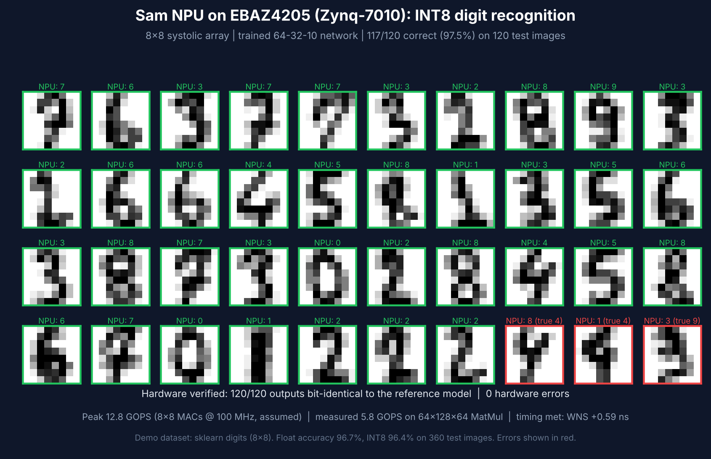
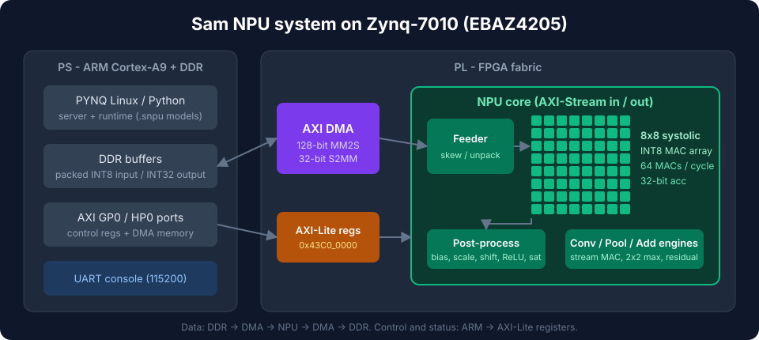

<div align="center">

# Sam NPU

**An INT8 neural-network accelerator in Verilog, running on a $10 FPGA board.**

8x8 systolic array · Zynq-7010 (EBAZ4205) · Vivado 2020.2 · PYNQ · MatMul, Conv, MaxPool, Add




</div>

A small INT8 NPU built around an **8x8 systolic multiply-accumulate array**, with the host software needed to
quantize a model, pack it into a `.snpu` file and run it on the board. The numbers below were measured on a real
EBAZ4205.

## Results (measured on a real EBAZ4205)

| What | Result |
|---|---|
| Timing (routed, Vivado 2020.2) | setup **WNS +0.593 ns**, hold **WHS +0.019 ns** |
| Resources (post-synthesis) | 7,629 LUT (43%), 8,480 FF (24%), 72 / 80 DSP (90%) |
| Hardware throughput | **~5.8 GOPS** on a 64x128x64 MatMul (peak 12.8 GOPS) - *assumes a 100 MHz clock* |
| Digit recognition demo | **117 / 120** correct on the board, outputs **bit-identical** to the reference model |
| MatMul vs independent numpy model | 14 / 14 cases identical, incl. -128 / +127 extremes |
| Stress | 300 consecutive jobs, 0 errors |

## Architecture



Data goes DDR -> AXI DMA -> NPU -> AXI DMA -> DDR. The ARM core programs the NPU through AXI-Lite registers.
The array computes INT8 x INT8 products with 32-bit accumulation; a post-process stage applies bias, a per-tensor
scale (`qmul`, `qshift`, zero point), ReLU and saturates back to INT8.

## Quick start (PYNQ on EBAZ4205)

1. Build the bitstream with Vivado 2020.2: `bash scripts/build_ebaz4205_final.sh`
   (boards without the 25 MHz PHY crystal: `scripts/build_ebaz4205_no_y3.sh`, see the notes in that script).
2. Copy `sam_npu.bit` + `sam_npu.hwh` (from the exported `.xsa`) and `sw/` to the board.
3. On the board, start the server and run the self-test:
   ```bash
   sudo -E python3 sw/host/npu_pynq_server2.py sam_npu.bit 9505 127.0.0.1 &
   python3 sw/host/npu_board_selftest.py 127.0.0.1
   ```
4. Try the demos: `sw/demo/digits_all.py` (digit recognition) and `sw/demo/chat_all.py` (a tiny intent chatbot whose
   "brain" runs on the NPU).

Step-by-step bring-up notes, including the UART + SD-card workflow and the systemd auto-start unit
(`scripts/npu.service`), are in [docs/PYNQ_BRINGUP.md](docs/PYNQ_BRINGUP.md).

## Repository layout

| Path | Contents |
|---|---|
| `rtl/` | Verilog: systolic array, feeder, post-process, Conv/Pool/Add engines, AXI wrappers |
| `sim/`, `verification/` | testbenches and Python checks (`validate_release.sh`, `verification/review51/`) |
| `scripts/` | Vivado project / block-design / build scripts, board support fetcher, `npu.service` |
| `sw/` | model packer, `.snpu` loader, host runtime, PYNQ server, benchmarks, demos |
| `docs/` | design notes, model format, bring-up guide |

## Honest limitations

- **Small models only so far.** Verified with MatMul-based networks. Conv, MaxPool and Add were checked against the
  project's own reference model on the board, not yet against an independent one.
- **The Python server is the bottleneck.** The array itself takes ~0.18 ms for a 64x128x64 MatMul, but a request
  through the Python server takes ~28 ms.
- **The clock is assumed to be 100 MHz** in the GOPS numbers; the real FCLK was not read back.
- **No long-duration or temperature testing.**
- **Ethernet did not come up** with the stock PYNQ image on the test board (the PHY was not detected); the board is
  driven over UART, with files moved on an SD card.
- **The ONNX converter is incomplete** (quantization, NCHW / NHWC), so there is no one-click path from a PyTorch /
  ONNX model yet.

## Roadmap

- C / numpy server to remove the Python bottleneck
- Small CNN (Conv + Pool) demo on real image data
- Complete the ONNX -> `.snpu` converter
- Fix Ethernet (PHY clock from the PL)
- Long-run stability and power measurements

## License

MIT - see [LICENSE](LICENSE). The original project notes are kept in [docs/PROJECT_NOTES.md](docs/PROJECT_NOTES.md).
